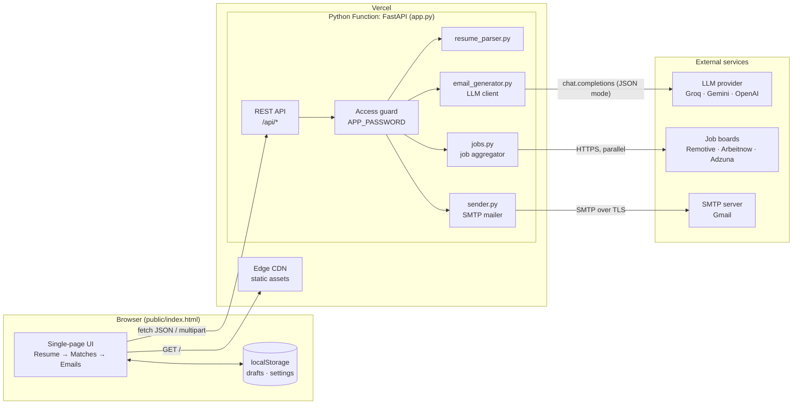
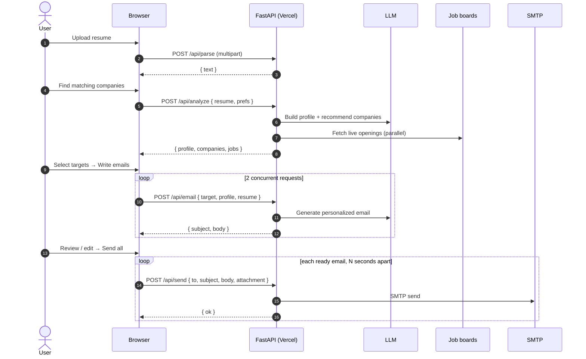

# Outreach — AI Cold Email Generator

Upload a resume, get matched with companies and live job openings, and send a personalized cold email to each one from your own Gmail account.

**Live demo:** https://ai-cold-email-generator-eight.vercel.app

   

---

## Table of Contents

1. [Overview](#overview)
2. [Features](#features)
3. [System Architecture](#system-architecture)
4. [Request Flow](#request-flow)
5. [Tech Stack](#tech-stack)
6. [Project Structure](#project-structure)
7. [API Reference](#api-reference)
8. [Getting Started](#getting-started)
9. [Deployment](#deployment)
10. [Configuration](#configuration)
11. [Security & Privacy](#security--privacy)
12. [Limitations](#limitations)
13. [Roadmap](#roadmap)
14. [License](#license)

---

## Overview

Cold outreach works when every email is specific to the company and the person reading it, but writing dozens of tailored emails by hand is slow. Outreach automates the repetitive parts of that process while keeping the user in control of what gets sent:

| Step | What happens |
|---|---|
| **1. Resume** | The user uploads a PDF/DOCX/TXT resume and sets preferences (target role, location, level, company type, industries, tone). |
| **2. Matches** | An LLM builds a candidate profile and recommends companies with a fit score, reasoning, target role, contact titles, and a company-specific "hook". Live postings are pulled from public job boards and ranked by skill overlap. |
| **3. Emails** | One email is generated per selected company or job. Each can be edited, rewritten (shorter / bolder / formal / warmer / new angle), and sent over SMTP with the resume attached, or opened as a Gmail/Outlook draft. |

## Features

- **Resume parsing**: PDF (`pypdf`), DOCX (`python-docx`, including tables) and plain text, with whitespace normalised.
- **Candidate profiling**: extracts headline, years of experience, top skills, strengths and best-fit roles.
- **Company recommendations**: fit score (0–100), a 2-sentence justification tied to the resume, target role, who to contact, and a factual hook to open the email with.
- **Live job openings**: aggregated concurrently from Remotive, Arbeitnow and (optionally) Adzuna, de-duplicated, location-filtered, and ranked by keyword overlap with the candidate's skills.
- **Personalized email generation**: 120–170 words, a specific opener, two quantified achievements, one low-friction ask, and a short subject line. It mirrors the job description when one is available.
- **One-click rewrites** that keep the previous draft as context.
- **Sending**
  - Direct SMTP (Gmail by default) with the resume attached.
  - Batch send with a configurable delay, a batch-size cap and a Stop button.
  - A "send me a test" button that sends to the sender's own inbox first.
  - Or a Gmail/Outlook compose link if the user prefers to press send themselves.
- **Pluggable LLM provider**: Groq (free tier, default), Google Gemini (free tier) or OpenAI, all through one OpenAI-compatible client.
- **Session persistence**: profile, matches and drafts survive a page reload (browser `localStorage`).

---

## System Architecture



### Components

| Component | Responsibility | Key design decisions |
|---|---|---|
| **Frontend** (`public/index.html`) | Three-step wizard, settings drawer, batch-send loop, state persistence. | Plain HTML/CSS/JS with no build step, served straight from the CDN. The batch-send loop runs **client-side**, so each email is its own short request and never runs into the serverless timeout. |
| **API layer** (`app.py`) | Request validation (Pydantic), access control, error mapping, routing. | Stateless: nothing is stored server-side. Per-request credentials (API key, SMTP) can come from headers/body or from environment variables. |
| **Resume parser** (`resume_parser.py`) | Binary file → clean text. | Runs in-memory. Rejects files over 3 MB (Vercel's request body limit is 4.5 MB). |
| **LLM client** (`email_generator.py`) | Prompting for profile, companies and emails. | A single OpenAI-compatible client with a provider table, so switching providers only changes `base_url` and model. JSON mode is used with a plain-prompt fallback and tolerant JSON extraction. Rate-limited calls are retried, honouring `retry-after`. |
| **Job aggregator** (`jobs.py`) | Fetch, normalise, de-duplicate, filter and rank job postings. | Sources are queried in parallel with a `ThreadPoolExecutor`. A failure in one source is reported but doesn't fail the request. |
| **Mailer** (`sender.py`) | SMTP delivery with attachment. | A context manager keeps one authenticated connection per request. Supports implicit TLS (465) and STARTTLS (587). |

---

## Request Flow



---

## Tech Stack

| Layer | Technology |
|---|---|
| Frontend | HTML5, CSS3, vanilla JavaScript (ES2020) |
| Backend | Python 3.12, FastAPI, Pydantic |
| AI | OpenAI Python SDK against OpenAI-compatible endpoints (Groq `openai/gpt-oss-120b` by default) |
| Parsing | pypdf, python-docx |
| Jobs data | Remotive API, Arbeitnow API, Adzuna API |
| Email | `smtplib` / `email.message` (stdlib) |
| Hosting | Vercel (Python Functions + Edge CDN) |

---

## Project Structure

```
.
├── app.py                # FastAPI app: routes, validation, access control
├── email_generator.py    # LLM provider table, prompts, JSON handling, retries
├── jobs.py               # Job board clients, normalisation, ranking
├── sender.py             # SMTP mailer with attachment support
├── resume_parser.py      # PDF / DOCX / TXT → text
├── config.py             # Environment / .env loader
├── public/
│   └── index.html        # Complete frontend (served by Vercel CDN)
├── requirements.txt
├── vercel.json           # Function config (maxDuration)
├── .env.example          # All supported environment variables
└── .devcontainer/        # Codespaces / VS Code dev container
```

---

## API Reference

All endpoints accept and return JSON unless noted. When `APP_PASSWORD` is set, every `POST` route requires the `X-App-Password` header.

| Method | Endpoint | Body | Response |
|---|---|---|---|
| `GET` | `/api/config` | — | Which features are configured server-side (never returns secrets). |
| `POST` | `/api/parse` | `multipart/form-data`: `file` | `{ text }` |
| `POST` | `/api/analyze` | `{ resume, prefs, count, live_jobs }` | `{ profile, companies[], jobs[], job_errors[] }` |
| `POST` | `/api/more` | `{ resume, profile, prefs, exclude[] }` | `{ companies[] }` |
| `POST` | `/api/email` | `{ target, profile, resume, sender_name, tone, links, recipient_name?, revision?, previous? }` | `{ subject, body }` |
| `POST` | `/api/send` | `{ to, subject, body, sender_name, attachment?: { name, b64 }, smtp?: { user, password } }` | `{ ok: true }` |

**Optional headers for AI routes:** `X-AI-Provider` (`groq` \| `gemini` \| `openai`), `X-AI-Key`, `X-AI-Model`. A key supplied by the user overrides the server's key.

**Errors** use standard status codes with a human-readable `detail`: `400` bad input or missing configuration, `401` bad credentials, `413` file too large, `422` unreadable file, `429` provider rate limit, `502` SMTP failure.

---

## Getting Started

### Prerequisites

- Python 3.10+
- A free Groq API key: https://console.groq.com/keys
- *(optional)* A Gmail account with an [App Password](https://myaccount.google.com/apppasswords)

### Run locally

```bash
git clone https://github.com/oindreela04/AI-cold-email-generator.git
cd AI-cold-email-generator

python -m venv .venv
source .venv/bin/activate          # Windows: .venv\Scripts\activate
pip install -r requirements.txt

cp .env.example .env               # add GROQ_API_KEY (and optionally EMAIL / EMAIL_PASS)
uvicorn app:app --reload           # http://localhost:8000
```

Alternatively, run `vercel dev` (Vercel CLI ≥ 48.1.8) to reproduce the production routing locally.

---

## Deployment

The project deploys to Vercel with zero configuration. Vercel detects the FastAPI app in `app.py` and serves `public/` from its CDN.

1. Import the repository at [vercel.com/new](https://vercel.com/new).
2. Add environment variables (see below) under **Project → Settings → Environment Variables**.
3. Deploy. Every push to `main` triggers a production deployment, and other branches get preview URLs.

`vercel.json` raises the function timeout to 60 s, which leaves headroom for the analysis step (typically 10–30 s).

---

## Configuration

| Variable | Required | Description |
|---|---|---|
| `GROQ_API_KEY` | Recommended | Free LLM key. If unset, users paste their own key in Settings. |
| `GEMINI_API_KEY` / `OPENAI_API_KEY` | Optional | Use Gemini or OpenAI instead. |
| `AI_PROVIDER` | Optional | Force a provider: `groq` \| `gemini` \| `openai`. |
| `AI_MODEL` | Optional | Override the provider's default model. |
| `APP_PASSWORD` | Recommended when keys are set | Shared password that protects the server's AI quota and mailbox. |
| `EMAIL` / `EMAIL_PASS` | Optional | Default sender address and Gmail App Password. |
| `SMTP_HOST` / `SMTP_PORT` | Optional | Non-Gmail SMTP servers (defaults `smtp.gmail.com` / `465`). |
| `ADZUNA_APP_ID` / `ADZUNA_APP_KEY` / `ADZUNA_COUNTRY` | Optional | Enables Adzuna listings (country defaults to `in`). |

---

## Security & Privacy

- **Stateless backend**: resumes, drafts and credentials are never written to disk or a database. They live only in the request and in the user's own browser.
- **Secrets stay server-side**: `/api/config` reports only *whether* a key is configured, never its value.
- **Access guard**: `APP_PASSWORD` is compared in constant time (`secrets.compare_digest`).
- **App Passwords, not account passwords**: Gmail sending requires a revocable, app-specific password.
- **Human in the loop**: nothing is sent without an explicit click. Recipients are entered by the user, and email addresses are never guessed or scraped.
- **Output escaping**: all model output is HTML-escaped before rendering.

## Limitations

- Company suggestions come from the language model's knowledge and can be out of date. Each card links to live LinkedIn search results for verification.
- Free LLM tiers are rate-limited per account (Groq: roughly 30 requests and 8K tokens per minute). The client throttles itself and the backend retries on `429`.
- Remotive and Arbeitnow skew towards remote and EU roles. Adzuna gives the best coverage for India.
- Gmail caps personal accounts at roughly 500 sends a day, and newer accounts are flagged sooner. Keep batches small.

## Roadmap

- [ ] Recipient discovery via a contacts API (e.g. Hunter, Apollo) with explicit opt-in
- [ ] Follow-up scheduling and reply tracking via the Gmail API (OAuth)
- [ ] Persistent workspaces (Postgres) with per-user authentication
- [ ] Export outreach history to CSV / Google Sheets
- [ ] Cover-letter generation from the same profile

---

## License

Released under the [MIT License](LICENSE). © 2026 Oindreela Saha
